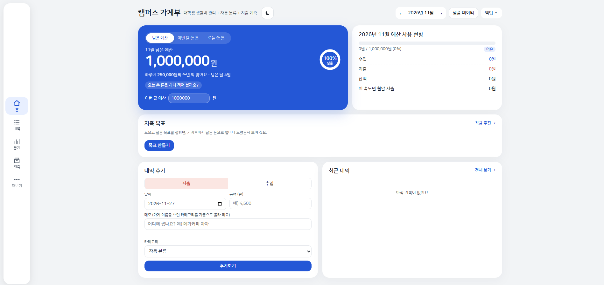

# team-13-project
# 캠퍼스 가계부 (Campus Ledger)

## 1. 프로젝트 소개
대학생과 사회초년생을 위한 자산 관리 및 가계부 웹사이트입니다. 수입과 지출을 기록하고 자신의 소비 습관과 자산 현황을 쉽게 파악할 수 있도록 제작했습니다.

## 2. 주요 기능
- 수입 및 지출 내역 기록
- 월별 수입과 지출 확인
- 소비 내역 및 자산 현황 관리
- 예산 및 잔여 금액 확인
- 또래와의 금융 현황 비교

## 3. 실행 화면
<!-- 실행 화면 이미지 추가 -->

## 4. 실행 방법
아래 주소에 접속하면 웹사이트를 이용할 수 있습니다.

배포 주소: (https://choyechan0812.github.io/team-13-project/)

## 5. 사용한 오픈소스
- 출처: 국무조정실 「2024년 청년의 삶 실태조사」 (국가승인통계 제170002호) (국무조정실 보도자료 2025.3) · 알바몬 「대학생 적정 용돈 수준 및 용돈 마련 방법」 설문 (2024, 대학생 1,181명) (뉴스1 2024.4 보도) · 알바몬 「생활비(용돈) 현황」 설문 (2025, 대학생 496명, 참고) (트윅 2026.9 보도 재인용, 원문 미확인) · 비누랩스 인사이트 대학생 설문 (2026, 에브리타임 대학생 500명) (벤처스퀘어 보도)
- 금융감독원 금융상품한눈에 오픈 API: 저축 탭의 적금 금리·상품 정보 / https://finlife.fss.or.kr

## 6. 팀원 및 역할

| 이름 | 역할 |
|---|---|
| 조예찬 | 팀장, 발표자료, 자료수집 |
| 이상현 | 디자인, 자료수집, 웹사이트 개발 |
| 조동환 | 자료수집, 발표자료수집, 발표 |
